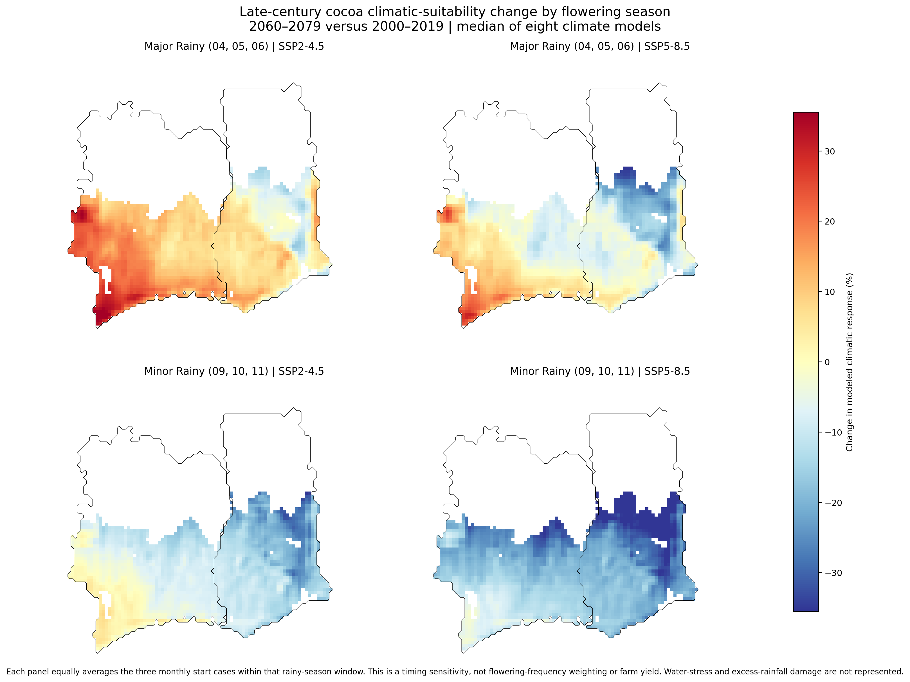
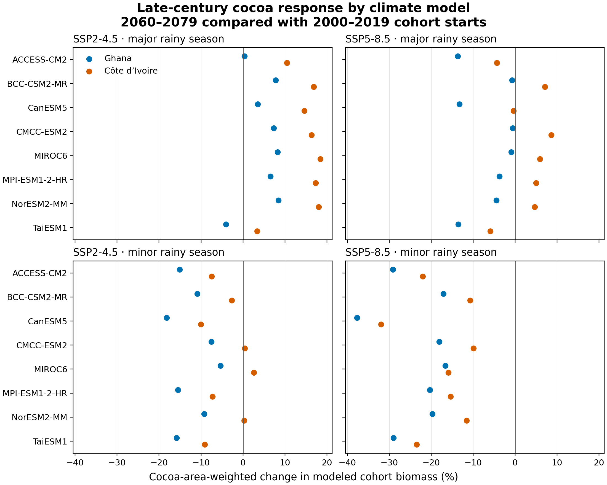

# SIMPLE-Cacao-WA

SIMPLE-Cacao-WA estimates how future temperature and shortwave radiation could change the modeled biomass response of cocoa flowering cohorts in Ghana and Côte d’Ivoire. The comparison uses a fixed mapped cocoa footprint and a historical climate reference. Read the percentages as changes in a modeled climate-response indicator. Farm-yield prediction is outside the study scope.

## Research question and analysis

The analysis asks how the modeled climate response changes between the historical reference period and 2060–2079. Ghana and Côte d’Ivoire are major cocoa producers covered by a single, consistently produced plantation map. This gives the comparison a common definition of mapped cocoa area across the national border. [Abu et al. mapping study](https://doi.org/10.1016/j.ecolind.2021.107863).

The two flowering-season windows cover different parts of the year.

- **Major rainy season** covers April, May and June.
- **Minor rainy season** covers September, October and November.

The windows follow the regional flowering pattern described by Claus et al., who report intense flowering during the rains that start in April and peak in June, and lower flowering intensity in September–November. For each window, the first day of each listed month is run as a separate cohort-start case. The three monthly changes are averaged equally for each climate model, and the map takes the median across eight models. The monthly cases test sensitivity to cohort timing. [Claus et al., flower phenology](https://doi.org/10.5772/intechopen.75361), [project calendar](03_parameters/flowering/cacao_seasonal_cohort_calendar.yml).

The historical cohort-start reference is 2000–2019, calculated from AgERA5 daily weather for 2000–2020 (2020 supplies trailing weather for late-2019 cohorts). Future cohorts start in 2060–2079. Their weather forcing includes 2080 to complete the final cohort cycles. The comparison is cellwise relative change from the historical reference.

## Main result



The table gives the cocoa-area-weighted mean of the mapped changes within each country. Each map cell first takes the median across eight global climate models (GCMs). The country calculation then averages those cell medians with mapped cocoa area as the weight. The percentages describe changes in a modeled cohort response.

| Flowering window | Scenario | Ghana | Côte d’Ivoire |
|---|---|---:|---:|
| Major rainy season (Apr–Jun) | SSP2-4.5 | +6.6% | +16.4% |
| Major rainy season (Apr–Jun) | SSP5-8.5 | -4.4% | +3.8% |
| Minor rainy season (Sep–Nov) | SSP2-4.5 | -12.7% | -4.6% |
| Minor rainy season (Sep–Nov) | SSP5-8.5 | -20.5% | -16.0% |

The modeled response falls in both countries for the September–November cases under both scenarios. The April–June cases have a mixed response under SSP5-8.5 and a positive country mean under SSP2-4.5. The simulation omits farm management, disease and farmer adaptation. See the limitations below for what the comparison can establish.

The four GeoTIFF maps, checksums, ensemble details, and country summaries are in [08_outputs/gridded/late_century_suitability_change](08_outputs/gridded/late_century_suitability_change) and its [map manifest](08_outputs/gridded/late_century_suitability_change/late_century_map_manifest.json).

The manifest field `gcm_direction_agreement_fraction_mean` measures the fraction of GCMs with a strictly positive change in each cell, averaged over mapped cocoa area. Values near zero indicate few positive responses. The field name is retained for compatibility with the archived outputs.

### Individual climate model results



Each dot is one climate model’s cocoa-area-weighted mean change for one country. The four panels share a horizontal scale, and the vertical line marks zero change. The 64-row CSV gives the values for eight models, two scenarios, two flowering windows and two countries. These country means are computed separately for each model from its seasonal cell changes. The headline table averages the cellwise ensemble medians. [Individual model CSV](08_outputs/gridded/late_century_suitability_change/late_century_individual_model_country_change.csv), [run manifest](08_outputs/gridded/late_century_suitability_change/late_century_map_manifest.json).

All eight models show a negative minor-season response in both countries under SSP5-8.5. Under SSP2-4.5, all eight show a negative minor-season response in Ghana, while five of eight do so in Côte d’Ivoire. [Individual model CSV](08_outputs/gridded/late_century_suitability_change/late_century_individual_model_country_change.csv).

## Data and methods

### Climate data

- **Future forcing** uses NASA NEX-GDDP-CMIP6 version 2.0 daily data at nominal 0.25° resolution. The archive provides precipitation (`pr`), minimum and maximum temperature (`tasmin`, `tasmax`), and surface downwelling shortwave radiation (`rsds`). One member (`r1i1p1f1`) is used for each of eight models: ACCESS-CM2, BCC-CSM2-MR, CanESM5, CMCC-ESM2, MIROC6, MPI-ESM1-2-HR, NorESM2-MM, and TaiESM1. The reader converts daily fluxes to mm/day or MJ/m²/day and temperature to °C, checks shared coordinates and calendars, and uses average resampling to align the fields to the 11-km grid. The effective climate resolution remains limited by the source data. [NEX-GDDP-CMIP6 paper](https://doi.org/10.1038/s41597-022-01393-4), [weather stream implementation](02_preprocessing/climate/weather_stream.py).
- **Historical reference** uses daily AgERA5 v2.0 from the Copernicus Climate Data Store for 2000–2020. The agriculture-oriented daily data provide temperature and radiation for the cohort response, with precipitation and reference evapotranspiration available for historical water-balance diagnostics. The stored historical model response is the baseline for the published future comparison. [AgERA5 documentation](https://doi.org/10.24381/cds.6c68c9bb), [acquisition manifest](01_inputs/manifests/agera5_full_extent_manifest.yml).
- **Climate-model diagnostics:** historical NEX-GDDP-CMIP6 files for 2000–2014 and CHIRPS v3 precipitation comparisons are used by separate screening and validation workflows. These are not the future scenario forcing or the source of the historical map baseline.

### Cocoa footprint and analysis grid

The cocoa mask uses Abu et al.'s Sentinel-derived plantation map for Ghana and Côte d’Ivoire. The same footprint is applied in both periods to compare responses on a common set of cocoa cells. Averaging the binary source classes onto the equal-area grid preserves fractional cocoa cover at the analysis scale. The source reports 82.89% producer's accuracy and 62.22% user's accuracy for cocoa. Classification errors can therefore change which cells receive weight. The derived cocoa fraction uses the source dataset under CC BY 4.0. [PANGAEA dataset](https://doi.org/10.1594/PANGAEA.917473), [mapping study](https://doi.org/10.1016/j.ecolind.2021.107863), [processing manifest](01_inputs/manifests/cocoa_mask_abu_manifest.yml).

### Soil and model configuration

Soil water-holding capacity uses ISRIC SoilGrids 2.0 median predictions (Q0.5) to supply one central soil profile per cell. The analysis does not propagate the dataset's prediction intervals. The baseline YAML records the settings used for the archived analysis. The historical and future runners obtain their crop values from the shared `published_cacao_parameters()` factory, while the sensitivity workflow reads its own case design. [SoilGrids 2.0 paper](https://doi.org/10.5194/soil-7-217-2021), [baseline configuration](03_parameters/crop/cacao_suitability_baseline.yml), [parameter factory](04_model/simple_cacao/parameters.py), [sensitivity configuration](03_parameters/crop/cacao_suitability_sensitivity.yml).

### Dataset provenance and citations

Use the references below to cite the data and methods. The acquisition and processing manifests record source URLs, licenses where available, and checksums. [Input manifests](01_inputs/manifests).

1. **NEX-GDDP-CMIP6:** Thrasher, B. et al. (2022). “NASA’s Global Daily Downscaled Projections, CMIP6.” *Scientific Data*, 9, 262. [https://doi.org/10.1038/s41597-022-01393-4](https://doi.org/10.1038/s41597-022-01393-4). NASA NCCS technical documentation: [https://doi.org/10.7917/OFSG3345](https://doi.org/10.7917/OFSG3345).
2. **AgERA5:** Boogaard et al. (2020), *Agrometeorological indicators from 1979 to present derived from reanalysis*. Copernicus Climate Change Service Climate Data Store. [Dataset documentation and DOI](https://doi.org/10.24381/cds.6c68c9bb).
3. **Cocoa map** comes from Abu, Szantoi, Brink, Robuchon and Thiel (2020), *Cocoa Map for Cote d'Ivoire and Ghana*. Cite the dataset and the accompanying Abu et al. (2021) study in *Ecological Indicators*, 129, 107863. [PANGAEA dataset](https://doi.org/10.1594/PANGAEA.917473), [mapping study](https://doi.org/10.1016/j.ecolind.2021.107863).
4. **SoilGrids 2.0:** Poggio et al. (2021) describe the mapped soil properties, including coarse fragments. Turek et al. (2023) describe the volumetric water-retention layers used for field capacity and wilting point. [SoilGrids 2.0 paper](https://doi.org/10.5194/soil-7-217-2021), [water-retention paper](https://doi.org/10.1016/j.iswcr.2022.08.001), [ISRIC documentation](https://docs.isric.org/globaldata/soilgrids/).
5. **Seasonal timing** draws on Claus et al. (2018), *Challenges in Cocoa Pollination: The Case of Cote d'Ivoire*, and Adjaloo et al. (2012), *Floral Phenology of Upper Amazon Cocoa Trees: Implications for Reproduction and Productivity of Cocoa*. [Claus et al.](https://doi.org/10.5772/intechopen.75361), [Adjaloo et al.](https://doi.org/10.5402/2012/461674).
6. **Model lineage** begins with Zhao et al. (2019), who introduced the generic SIMPLE crop model. Romero Vergel et al. (2022) supply the published cacao parameter anchors used here. The crop observations and calibrations in that study pertain to Colombia. [A SIMPLE crop model](https://doi.org/10.1016/j.eja.2019.01.009), [A Crop Modelling Strategy to Improve Cacao Quality and Productivity](https://doi.org/10.3390/plants11020157).
7. **CHIRPS v3:** cite Funk et al. (2026) and the dataset for the optional monthly rainfall comparison. [Product paper](https://doi.org/10.1038/s41597-026-07096-4), [dataset](https://doi.org/10.15780/G2JQ0P).
8. **Ghana farm context:** Asante et al. (2021) documents farm-level yield variability in Ghana. The repository retains a reference record for that study. [Paper](https://doi.org/10.1016/j.agsy.2021.103214), [project manifest](01_inputs/manifests/asante_ghana_manifest.yml).
9. **This software and analysis:** cite the contributor metadata and the Git revision used. [CITATION.cff](CITATION.cff).
10. **Country boundaries** come from geoBoundaries ADM0 polygons, cited as Runfola et al. (2020). The grid assigns countries using each cell's center and excludes ambiguous overlaps from the cocoa analysis. The recorded boundary IDs and hashes identify the inputs to the archived grid. [geoBoundaries paper](https://doi.org/10.1371/journal.pone.0231866), [grid manifest](01_inputs/manifests/model_grid_full_extent_manifest.yml).

### How a daily weather series becomes a map value

1. **Choose the cells.** The model uses a shared 11,000 m equal-area grid in EPSG:6933. Each country cell with positive mapped cocoa fraction contributes to the analysis. A common grid aligns the weather, soil and cocoa layers. Equal cell areas allow the country calculation to use cocoa fractions directly as relative area weights. The acquisition bounding box extends beyond the two countries to cover their full analysis domain. The archived runs include 2,541 cocoa cells, 1,168 in Ghana and 1,373 in Côte d’Ivoire. One Côte d’Ivoire country cell lacks a cocoa source fraction and is excluded. [Study configuration](config/study.yml), [grid manifest](01_inputs/manifests/model_grid_full_extent_manifest.yml), [historical run coverage](08_outputs/gridded/historical_climatic_suitability/historical_run_manifest.json).
2. **Run a cohort for each start month and year.** Daily temperatures drive thermal-time accumulation and the crop temperature factor. Accumulated thermal time governs canopy interception and maturity. Daily biomass accumulation uses intercepted shortwave radiation, radiation-use efficiency, temperature and heat-stress factors. The simulation ends at maturity or the 260-day cycle cap. The baseline uses 2,016 degree-days and 0.6 g/MJ from the Santander anchor, a 10 °C base and 26 °C optimum, and heat thresholds of 35 °C and 40 °C. Using published anchors gives an explicit starting point for a region without local fitting. Transfer of those parameters is a study assumption. [Baseline values](03_parameters/crop/cacao_suitability_baseline.yml), [scalar crop model](04_model/simple_cacao/crop.py), [vectorized crop model](04_model/simple_cacao/vectorized.py), [Colombian cacao study](https://doi.org/10.3390/plants11020157).
3. **Compare like start months.** For each cell and start month, average the completed responses across the 20 historical start years and, separately, across the 20 future start years for each model and scenario. Calculate `100 × (future mean / historical mean − 1)`. A nonpositive historical mean or a nonfinite response raises an error. Matching start months keeps the baseline seasonal. Equal-length periods keep the comparison consistent, and the extra year of daily forcing lets late-starting cohorts finish. The periods are study design choices. [Map implementation](04_model/run_late_century_suitability_map.py), [historical run manifest](08_outputs/gridded/historical_climatic_suitability/historical_run_manifest.json).
4. **Summarize each season and scenario.** Average the three monthly changes within a model, then take the cellwise median across the eight models. Equal month weights define an interpretable timing experiment because the observations do not provide transferable flowering frequencies. The same fixed month starts are applied in both periods and countries. The first day is a reproducible convention. The Ghana observations include a July flowering peak at their study site, so April–June should be read as the chosen early major-season window. [Cohort calendar](03_parameters/flowering/cacao_seasonal_cohort_calendar.yml), [Ghana flowering observations](https://doi.org/10.5402/2012/461674).
5. **Summarize across cocoa area.** Within a country, compute `sum(cocoa fraction × cell median) / sum(cocoa fraction)` over selected cells. This summarizes the change where mapped cocoa occupies more area. It gives each hectare of mapped cocoa equal weight under the grid approximation. [Map code](04_model/run_late_century_suitability_map.py), [map manifest](08_outputs/gridded/late_century_suitability_change/late_century_map_manifest.json).

### Why these scenarios and model weights

SSP2-4.5 and SSP5-8.5 provide an intermediate and a very high forcing case for the same late-century window. The results are conditional on those scenarios. Each GCM contributes one member and one value to the median, which limits the influence of individual extremes. Equal treatment is the reference design because the historical diagnostics do not establish defensible weights for future cocoa response. Model dependence and individual-member variability remain sources of uncertainty. The historical weighting sensitivity groups CMCC-ESM2, NorESM2-MM and TaiESM1 together as a heuristic based on shared atmosphere and land model components. The final seasonal map uses equal model weights. [IPCC AR6 scenario definitions](https://www.ipcc.ch/report/ar6/wg1/chapter/summary-for-policymakers/), [projection weighting study](https://doi.org/10.1002/2016GL072012), [archived CMIP6 model metadata](01_inputs/external/cmip6_metadata/manifest.json), [ensemble configuration](config/gcm_ensemble_proposal.yml), [weight sensitivity manifest](06_validation/historical_gcm/daily_spatial/ensemble_weight_sensitivity_manifest.json).

### How to interpret the parameter choices

The baseline uses the Santander thermal-time and radiation-use-efficiency pair as one published reference among the five Colombian calibrations. The repository contains no evidence that Santander is the closest analogue for either study country. The historical sensitivity screen spans the Colombian thermal-time anchors as a deterministic stress test. A fixed radiation-use efficiency scales both periods equally and cancels in their ratio. The maps use biomass directly, so the harvest index has no role in the mapped change. [Colombian cacao study, Table 1](https://doi.org/10.3390/plants11020157), [published anchors](03_parameters/crop/cacao_published.yml), [sensitivity design](03_parameters/crop/cacao_suitability_sensitivity.yml).

The crop model uses the midpoint of the daily minimum and maximum temperatures. Mean temperature controls thermal time and raises the growth factor from zero at the base temperature to one at the optimum. Maximum temperature independently lowers the heat factor from one at 35 °C to zero at 40 °C. The canopy interception curve has separate increasing and decreasing phases in thermal time. Those functions make the result sensitive to both the timing of weather within a cohort and the number of days before maturity. The future runner rejects a cohort that reaches the cycle cap before thermal maturity. [Generic SIMPLE model](https://doi.org/10.1016/j.eja.2019.01.009), [model equations](04_model/simple_cacao/vectorized.py), [future runner](04_model/run_late_century_suitability_map.py).

Setting the CO₂ coefficient (`S_CO2`) to zero avoids translating the Colombian paper's reported CO₂–RUE term into a per-ppm coefficient without a verified mapping. The published cacao setup also used zero sensitivity to water deficit (`S_water`). Future weather lacks reference evapotranspiration (`ET0`). The main comparison therefore leaves water deficit, waterlogging and CO₂ fertilization outside the response calculation. The 1,500 mm root depth is a provisional project default bracketed by 1,000 and 2,000 mm in the soil sensitivity design. Soil preparation integrates the difference between field capacity and wilting point through each depth, adjusting for coarse fragments. This provides comparable available water capacity (AWC) inputs for experiments with water stress enabled. [Cacao parameter audit](03_parameters/crop/cacao_published.yml), [soil priors](03_parameters/soil/soil_priors.yml), [soil preparation](02_preprocessing/soils/soil_inputs.py).

### What the checks establish

| Check or experiment | Evidence and scope |
|---|---|
| Forcing availability and integrity | The scenario audit records inspected files and completeness. The endpoint stream check covers the cases listed in its report. [Full scenario audit](06_validation/historical_gcm/scenario_full_audit.json), [stream verification](06_validation/forcing_stream/endpoint_stream_verification.json). |
| Historical climate plausibility | The 2000–2014 NEX comparison uses AgERA5 to examine historical climate behavior, including country/month diagnostics and daily or spatial summaries. CHIRPS v3 provides a separate monthly rainfall comparison. [GCM screening manifest](06_validation/historical_gcm/screening_manifest.json), [daily spatial diagnostics](06_validation/historical_gcm/daily_spatial/manifest.json), [CHIRPS manifest](01_inputs/manifests/chirps_manifest.yml). |
| Crop parameter sensitivity | The archived historical screen runs 19 cases, one reference and a low and high setting for each of nine crop or soil parameters, changing one parameter at a time. A separate future sensitivity would be needed to quantify how the published map changes under these settings. [Sensitivity design](03_parameters/crop/cacao_suitability_sensitivity.yml), [historical screening manifest](07_runs/sensitivity/historical_screening/screening_manifest.json). |
| Historical model output | The historical run produces a cohort response raster and a separate relative suitability index. The future comparison uses the cohort response raster as its denominator source. [Historical outputs](08_outputs/gridded/historical_climatic_suitability), [historical diagnostics](09_analysis/historical_suitability/baseline_diagnostics_manifest.json). |

The archived CHIRPS check compares 252 monthly totals for 2000–2020 on the 0.1° AgERA5 grid. The reported annual area-weighted AgERA5 precipitation bias relative to CHIRPS is +21.48% in Ghana and +7.97% in Côte d’Ivoire. The comparison has complete paired coverage in the assigned country cells. These results describe a difference between gridded precipitation products and help contextualize any water-balance experiment. [CHIRPS comparison design and outputs](01_inputs/manifests/chirps_manifest.yml).

The historical denominator uses AgERA5, while the future numerator uses downscaled GCM forcing. Residual differences between those products can therefore contribute to the modeled change. The historical climate comparisons help characterize those differences. The fixed footprint describes exposure on mapped cocoa land, and the analysis gives no estimate of future planted area. The ensemble median describes this selected set of simulations, with no probabilistic confidence interval.

The submitted study uses published crop parameters and gridded climate, soil and cocoa-cover inputs. Farm-level records were unavailable to the project, so farm-data collection, local yield calibration and validation against observed farm yields are outside the submission scope. Asante et al. provides published context on yield variability in Ghana. [Ghana farm study](https://doi.org/10.1016/j.agsy.2021.103214), [reference provenance](01_inputs/manifests/asante_ghana_manifest.yml).

## Data included in this repository

The repository includes the code, configuration, source manifests, checksums, small processed map inputs, model outputs and figures. Raw datasets, bulk AgERA5 daily rasters, bulk CHIRPS files and the retrieved reference-article PDF are local inputs covered by Git ignore rules. The manifests record their sources and processing. [Git ignore rules](.gitignore).

The full future NEX-GDDP-CMIP6 time series is needed to regenerate the future map, but is intentionally acquired separately rather than stored in Git. From the project root, `python .\workflow\cli.py scenarios` downloads and audits the 1,344 regional daily NetCDF files for the eight models, two scenarios, four variables, and years 2060–2080. This is a multi-gigabyte download. The historical AgERA5 reference raster and the small static rasters needed by the map are already included.

AgERA5 source downloads require a Copernicus Climate Data Store account and accepted dataset terms. Historical climate screening, precipitation validation and raw-input preparation may require additional downloads. The map workflow can start with the archived historical reference and processed inputs.

## Reproduce the map

Create the Conda environment from the project root.

```powershell
conda env create -f .\13_env\environment.yml
conda activate simple-cacao-wa
```

On Windows, use these commands to download and audit the future forcing and generate the figure and four GeoTIFFs.

```powershell
python .\workflow\cli.py scenarios
python .\workflow\cli.py map --output-dir .qa_map_reproduction
```

The output directory receives the four rasters, the ensemble map figure, the individual model CSV and figure, and a run manifest. Choose a fresh directory for each run. The default output locations already contain the archived results, and the runner protects them from overwrites. The scenario wrapper uses Windows file locking. On Linux or macOS, use the two underlying commands below in place of `scenarios`. Both routes acquire and audit the archive.

```bash
python workflow/cli.py scenario-download --all-years --workers 4
python workflow/cli.py scenario-audit --all-years
python workflow/cli.py map --output-dir .qa_map_reproduction
```

### Rebuild supporting inputs and diagnostics

Run each command below as `python workflow/cli.py <command>` from the project root. The prepared grid, cocoa fraction, AWC raster and historical cohort response are already included for the map workflow.

| Task | Commands and inputs |
|---|---|
| Prepare the grid | Run `agera5-download` and place the pinned Ghana and Côte d’Ivoire boundary GeoJSON files in `01_inputs/raw/boundaries/`. Run `grid` to snap the grid to projected AgERA5 bounds and assign country codes. Use the boundary IDs and checksums in the grid manifest to identify the expected files. [Grid manifest](01_inputs/manifests/model_grid_full_extent_manifest.yml). |
| Prepare cocoa fractions | Run `cocoa-map-download`, extract the RAR so that `GHAKakao.tif` and `CIVKakao.tif` are inside `01_inputs/raw/cocoa_map_abu_2020/Detected Cocoa Farms/`, then run `cocoa-mask-prepare`. [Cocoa map manifest](01_inputs/manifests/cocoa_mask_abu_manifest.yml). |
| Prepare soil profiles | Run `soil-download` to retrieve field capacity, wilting point and coarse fragments across the configured depths. Run `soil-prepare` to generate the AWC bands and a companion imputation flag raster. [SoilGrids manifest](01_inputs/manifests/soilgrids_full_extent_manifest.yml). |
| Rebuild the historical baseline | With the static inputs in place, run `agera5-download`, `agera5-prepare` and `historical`. The historical runner requires `--overwrite` if you choose to replace the archived baseline in your working copy. Use `historical-summary` for historical diagnostics and `sensitivity` for the optional historical parameter screen. [Historical runner](04_model/run_historical_suitability.py), [sensitivity runner](04_model/run_historical_suitability_sensitivity.py). |
| Inspect climate forcing | Run `historical-climate-download` before `historical-gcm-screen`. Run `rainfall-validation` for the monthly CHIRPS comparison and `weather-check` for the endpoint weather stream checks. [Workflow inventory](workflow/cli.py). |

Run `python workflow/cli.py --help` for the command list. The project uses pytest and Ruff for local checks.

```powershell
python -m pytest
python -m ruff check .
```

The published map manifest preserves the hashes recorded by that run. Its entries for the scenario acquisition manifest and audit differ from the later records in this checkout. The current audit identifies the current acquisition manifest by SHA-256, and the weather reader checks each input file against that manifest before reading it. A new map run records the inputs it used. Compare raster data and masks when validating a rerun across library versions, since GeoTIFF and PNG encodings can vary.

Some historical diagnostics record the script names or absolute paths from the run that created them. The current entry points are `historical-summary` in the historical analysis module and `gcm-weights` in the GCM diagnostics module. The archived sensitivity CSVs match their recorded checksums. Two parameter file hashes in the sensitivity manifest differ from the files in this checkout, so exact verification of those original inputs requires their historical revisions. [Historical analysis code](09_analysis/historical_suitability.py), [GCM diagnostics code](09_analysis/gcm_diagnostics.py), [sensitivity manifest](07_runs/sensitivity/historical_screening/screening_manifest.json).

GitHub Actions runs the tests and Ruff on pushes and pull requests. For container-based testing, run `docker compose -f 13_env/docker-compose.yml up --build`. The Docker build context excludes bulk inputs and published results, so this service runs the tests. Use the Conda workflow above to reproduce the maps with the local data. [CI configuration](.github/workflows/ci.yml), [container configuration](13_env/docker-compose.yml).

## Compute energy and carbon emissions

The reference benchmark tracks two stages separately on a Windows computer using CodeCarbon in offline process mode. The historical stage rebuilds the 2000–2019 cohort baseline from prepared AgERA5 rasters. The late-century stage reads the archived historical baseline and local scenario files, regrids scenario weather, runs all eight models under both scenarios and writes the maps and comparison outputs. CodeCarbon estimates electricity use in kWh and converts it to kg CO₂e using 384.4 g CO₂e per kWh, its offline United States grid factor for this run.

| Workflow | Tracked time (s) | Estimated energy (kWh) | Estimated emissions (kg CO₂e) |
|---|---:|---:|---:|
| Historical baseline | 115.3 | 0.000427 | 0.000164 |
| Late-century mapping | 717.9 | 0.00263 | 0.00101 |
| **Total** | **833.2** | **0.00306** | **0.00117** |

The total comes from one successful run of each stage. See the exported values and hardware metadata in the [CodeCarbon benchmark CSV](08_outputs/compute_emissions/codecarbon.csv).

The benchmark covers these two reproducible runs. Raw-data download and preparation of the archived inputs, exploratory screening, software development, earlier runs and hardware manufacture are outside the measured boundary. The benchmark used CodeCarbon 3.3.3 on an Intel Core i7-6600U with four logical CPUs and no GPU. The tracker estimated CPU energy from CPU load and rated power, and estimated RAM energy with its RAM power model. These figures depend on the hardware, tracking method, runtime and electricity mix. [CodeCarbon software citation](https://doi.org/10.5281/zenodo.11171501), [tracking methods](https://docs.codecarbon.io/latest/how-to/configuration/), [output units](https://docs.codecarbon.io/latest/reference/output/).

From the project root, install the carbon-tracking extra and use fresh output paths. Set `--country` to the machine's physical location and optionally pass a supported grid region with `--region`.

```powershell
python -m pip install ".[carbon]"
python workflow/measure_emissions.py --country USA --output .qa_carbon/historical.csv historical --output-dir .qa_carbon/historical
python workflow/measure_emissions.py --country USA --output .qa_carbon/map.csv map --output-dir .qa_carbon/map
```

## Project layout

- `01_inputs/` — source manifests, small processed map inputs, and external metadata
- `02_preprocessing/`, `03_parameters/`, `04_model/` — data preparation, parameterization, model, and tests
- `06_validation/`, `07_runs/`, `09_analysis/` — validation, run records, and supporting analysis
- `08_outputs/`, `10_figures/` — gridded results, summaries, and figures
- `11_notebooks/`, `13_env/`, `workflow/` — notebooks, environment, and workflow entry points
